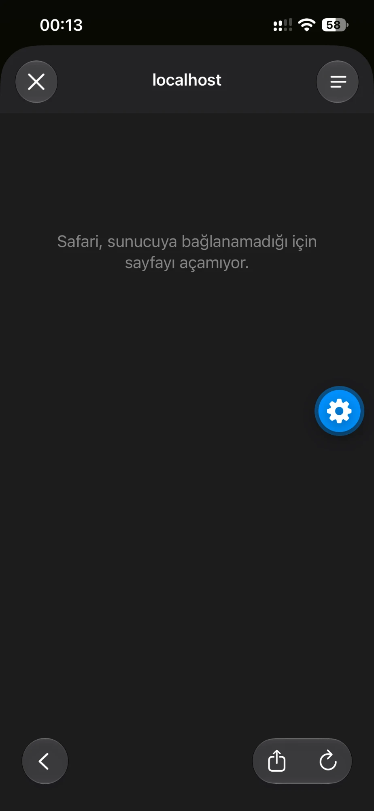
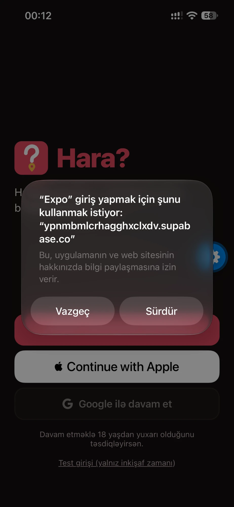
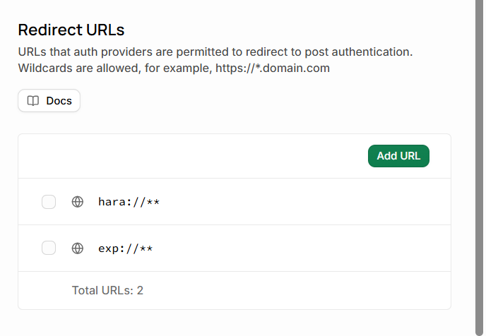

# BUG-008 Google Sign-In: after choosing the account, Safari shows "can't connect to server" (localhost)

| Field | Value |
|---|---|
| **ID** | BUG-008 |
| **Type** | Functional – authentication |
| **Severity** | Critical |
| **Priority** | P1 |
| **Status** | Fixed – Verified |
| **Component** | Mobile app → Sign-in → "Google ilə davam et" |
| **Reported** | 2026-11-02 |
| **Reporter** | Mukhtar Zakariyayev |
| **Fixed in** | PR #14 (`fix/google-sign-in-expo-go`) |

## Environment
- iPhone, iOS 18, Expo Go
- Auth: Supabase + Google OAuth (Testing mode, tester's Gmail added as test user)

## Preconditions
- Google provider enabled in Supabase.
- `exp://**` and `hara://**` added to the redirect allow-list.

## Steps to reproduce
1. Open the app signed out.
2. Tap **Google ilə davam et (Continue with Google)**.
3. Confirm the system dialog "'Expo' wants to use … to sign in" → **Continue**.
4. Choose the Google account.

## Expected result
The browser closes, the app is signed in and the profile setup screen opens.

## Actual result
The in-app browser navigates to **localhost** and shows "Safari can't open the page because it can't connect to the server". The user is not signed in.

## Evidence
- 
- 
- 

## Frequency
Always (4 of 4 attempts), also after adding the exact app URL to the allow-list.

## Investigation
1. Auth logs: Google login **succeeded** on the server (user account created) but the app never exchanged the code → the problem is the redirect back to the app.
2. The redirect target sent by the app was `exp://192.168.1.100:8082/--/auth-callback`.
3. Probing the auth server with different redirect targets:
   - `hara://auth-callback` → accepted
   - `exp://abc/--/x` → accepted
   - `exp://192.168.1.100:8082/--/auth-callback` → **rejected**, fallback to Site URL `http://localhost:3000`

## Root cause
The auth server refuses redirect URLs whose host is an IP address and silently falls back to the Site URL (`localhost`). In Expo Go the app's own address always contains the computer's local IP.

## Fix
In Expo Go the app now uses an IP-free redirect `exp://auth-callback`. iOS's sign-in sheet returns control to the app based on the URL scheme (`exp://`) only, so the code still reaches the app. Store builds use `hara://auth-callback`.

## Verification
2026-11-02 — Google sign-in on iPhone completes and opens the profile screen. ✅

## Known limitation
This workaround is iOS-specific; Android testing requires a development build.
