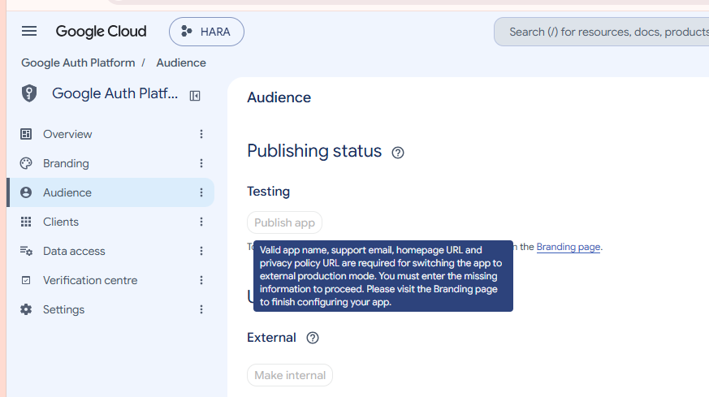

# DOC-001 Google sign-in setup guide asked for fields that are not shown and a step that is blocked

| Field | Value |
|---|---|
| **ID** | DOC-001 |
| **Type** | Documentation |
| **Severity** | Low |
| **Priority** | P3 |
| **Status** | Fixed – guide corrected |
| **Component** | Setup instructions → Google Cloud OAuth consent screen |
| **Reported** | 2026-11-02 |
| **Reporter** | Mukhtar Zakariyayev |

## Description
The step-by-step guide for enabling Google sign-in instructed to:
1. Fill **Privacy policy link** and **Terms of service link** under *Branding* — these fields were not present on the screen at that point.
2. Click **Publish app** under *Audience* — the button was disabled with the message "Valid app name, support email, homepage URL and privacy policy URL are required for switching the app to external production mode".

## Evidence

## Expected result
Every instruction matches what the user actually sees and can be completed.

## Actual result
Two steps could not be completed; the tester stopped and asked for clarification twice.

## Resolution
Guide updated: keep the app in **Testing** mode and add testers under *Audience → Test users* (up to 100). Publishing (with homepage + privacy URL on an owned domain) moved to the store-release checklist.

## Lesson
Third-party consoles change often — verify setup guides against the current UI, or include screenshots.
